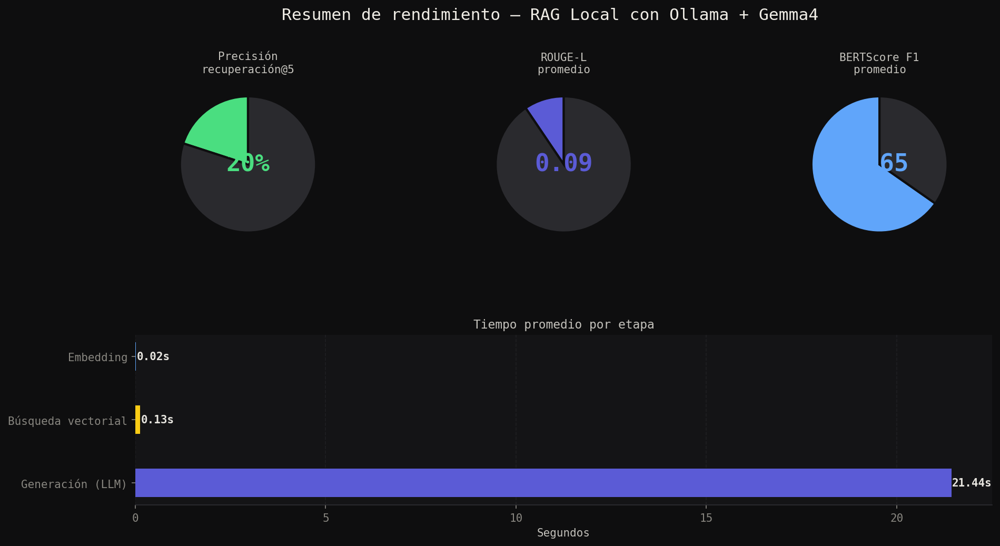

# RAG local con Ollama y Streamlit

Proyecto experimental de Retrieval-Augmented Generation para consultar documentos PDF, TXT y Markdown. Utiliza `nomic-embed-text` para embeddings, similitud coseno para recuperación y `gemma4:latest` para generar respuestas mediante Ollama.

Incluye una interfaz de chat con fuentes, indexación de documentos nuevos o modificados y un módulo de evaluación con gráficos.

## Requisitos

- Python 3.10 o superior.
- [Ollama](https://ollama.com) instalado y en ejecución.
- Memoria y espacio suficientes para los modelos elegidos. El rendimiento depende del modelo y del equipo.

## Instalación

```bash
git clone https://github.com/oagg/RAG-Project.git
cd RAG-Project
python3 -m venv .venv
source .venv/bin/activate
pip install -r requirements.txt
ollama pull gemma4
ollama pull nomic-embed-text
```

En Windows, activa el entorno con `.venv\Scripts\activate`. Ejecuta los siguientes comandos desde la raíz del repositorio. Puedes cambiar `CHAT_MODEL` en `notebooks/rag.py` por otro modelo disponible en tu instalación de Ollama.

## Prueba rápida

El repositorio incluye un documento de ejemplo original:

```bash
python notebooks/rag.py --index examples
python notebooks/rag.py --ask "¿Qué función cumplen los embeddings en este proyecto?"
streamlit run notebooks/app.py
```

La interfaz se abre en `http://localhost:8501`. Permite cargar e indexar documentos desde la barra lateral y consultar las fuentes recuperadas.

Para trabajar con documentos propios:

```bash
mkdir -p data/docs
# Copia tus documentos a data/docs antes de ejecutar:
python notebooks/rag.py --index data/docs
```

El índice se guarda en `vector_db.json`. Las siguientes consultas lo reutilizan. Al volver a indexar una carpeta, se omiten los archivos sin cambios y se reemplazan los fragmentos de los archivos modificados.

Los documentos personales, índices, entornos virtuales y archivos `.env` se excluyen de las nuevas versiones. Los libros y papers usados en los experimentos originales no se distribuyen en la versión actual; aporta tus propias copias. Las versiones anteriores del repositorio pueden conservar archivos retirados en su historial.

## Arquitectura

```text
PDF / TXT / Markdown
  → extracción de texto (PyMuPDF para PDF)
  → fragmentos de 800 caracteres con 150 de solapamiento
  → embeddings con nomic-embed-text mediante Ollama
  → índice JSON local

Pregunta → embedding → similitud coseno → 5 fragmentos
  → contexto para Gemma mediante Ollama → respuesta y fuentes
```

El JSON guarda `chunks` (texto y nombre de la fuente), `embeddings` e `indexed_files` (rutas y hashes de los archivos). No almacena números de página ni identificadores de fragmento. La extracción de PDF utiliza el texto que ofrece PyMuPDF, sin limpieza específica de encabezados o pies de página.

## Evaluación

```bash
pip install -r requirements-analytics.txt
python notebooks/analytics.py
```

El módulo contiene cinco preguntas con documentos esperados y respuestas de referencia sobre Attention, RAG, REALM, Goodfellow y Russell & Norvig. Para reproducir esa evaluación debes indexar esos documentos con los nombres indicados en `EVAL_DATASET` dentro de `notebooks/analytics.py`, o adaptar el conjunto a tus documentos. El archivo de ejemplo sirve para probar el flujo y no reproduce esos resultados.

Se calculan:

- **Hit@5 por documento:** proporción de preguntas cuyo documento esperado aparece entre los cinco fragmentos recuperados. No mide Precision@5 de fragmentos relevantes.
- **ROUGE-L y BERTScore:** comparación de respuestas generadas con referencias.
- **Tiempos por etapa y similitudes:** recuperación y generación.

BERTScore puede descargar un modelo la primera vez que se ejecuta. Si falta una dependencia de evaluación, el código devuelve cero para esa métrica; ese valor no debe interpretarse como un resultado válido.

Los PNG y el informe incluidos corresponden a experimentos anteriores. Sus etiquetas pueden usar “precisión” para la tasa de aciertos. No representan una evaluación general del sistema ni una comparación controlada entre modelos.



## Estructura

```text
notebooks/rag.py             Backend y comandos de indexación y consulta
notebooks/app.py             Interfaz Streamlit
notebooks/analytics.py       Evaluación y gráficos
examples/                   Documento de prueba distribuible
requirements.txt            Dependencias de la aplicación
requirements-analytics.txt  Dependencias adicionales de evaluación
data/docs/                  Documentos locales (ignorado)
vector_db.json              Índice generado (ignorado)
```

## Limitaciones

- El índice completo se carga en RAM. La búsqueda compara todos los vectores y ordena las similitudes; no utiliza un índice aproximado.
- No hay reranking ni eliminación automática de documentos retirados de una carpeta.
- La interfaz muestra el historial, pero el generador recibe cada pregunta de forma independiente.
- Las fuentes se identifican por nombre de archivo; conviene evitar nombres duplicados entre carpetas.
- El contexto recuperado no garantiza respuestas correctas ni elimina las alucinaciones.
- La evaluación tiene cinco preguntas y utiliza el documento de origen como criterio de acierto, sin anotaciones de relevancia por fragmento.
- Las dependencias no están fijadas a versiones concretas.
- La inferencia y la indexación se ejecutan localmente; la interfaz carga fuentes de Google Fonts y la evaluación puede necesitar descargas externas.
